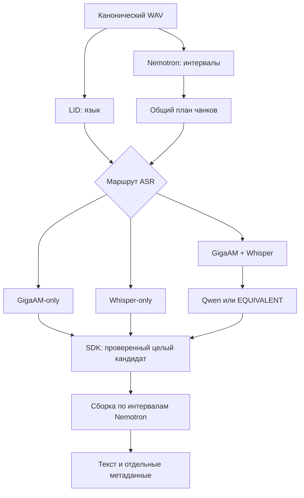

# Quality engine: неизменяемые кандидаты и процессы

Контракты текущего ядра; число обработчиков, пропуск тишины и ресурсный допуск описаны также в [режимах и очередях](queued-audio-modes.md). Изоляция процессов не означает строго последовательный запуск всех стадий.

Контракты актуализированы 8 ноября 2026. Один активный job, ограниченные очереди и ресурсный допуск в `:inference0..3`; Large и Qwen эксклюзивны. LID выполняется отдельно от ASR. Успешный `ru` даёт GigaAM-only; `be` и ошибка LID — две ASR; другой определённый язык — Whisper-only. Имена при наличии свидетельств могут определяться Qwen на любом маршруте. [Таблица маршрутов](../ARCHITECTURE.md#языковые-маршруты).

Две ASR получают общий план и одну ASR-копию; QUALITY может применять GTCRN только к этой копии. Диаризация, voiceprints и эмоции используют оригинал. RAW существуют только у реально запущенных источников. `fullProfileCompleted` обозначает прежний полный двух-ASR/LLM-профиль, а не универсальную готовность текста.

ERes2Net читает короткие окна прямо из исходного WAV. `PcmAudio` различает собственный временный PCM и заимствованное WAV-представление со смещением data: только собственный файл удаляется при close. Энергии и AGC считаются по прежним отсчётам; отдельная полная voiceprint-копия не нужна. Fingerprint обработки голосов не меняется.

Причина разделения процессов: release модели не гарантирует возврата всех арен native allocator и ORT. Bound service `:inference` уничтожается между стадиями; IPC передаёт только пути и маленькие управляющие сообщения. После завершения требуется смерть конкретного Binder. У native children установлен parent-death SIGKILL; recovery ограничен зарегистрированными дочерними процессами с проверкой PID reuse.

Состояние job записывается атомарно с fsync. Requestnonce связывает ответ с текущей попыткой. Отдельный terminal artifact защищает memory-error от позднего промежуточного checkpoint. Отмена не удаляет готовые raw artifacts. Отсутствие подтверждённого завершения worker запрещает следующий запуск с потенциальным пересечением моделей.

Единая шкала: integer samples16kHz. Чанки ChunkPlan вместе с явно записанными omittedRanges покрывают все samples без дыр и дублей; тишина вне плана не подаётся ASR. GigaAM и Whisper получают точно те же байты. Каждый кандидат содержит source/chunk/inputSHA, дословный text, native tokens и относительные times. Исходные native JSON сохраняются отдельно; производные слова/спикеры не переписывают их. AcousticTurnTranscript сохраняет отдельные интервалы Nemotron с их start/end, включая overlap, и размещает слово только в одном интервале по наибольшему пересечению. При изменении последовательности слов остаётся предыдущая сборка. Слова вне интервалов — speaker_unknown.

LLM не передаёт окончательный текст. Локальный инструмент принимает строго три строки: tool/chunk_id/source, запрещает дополнительные поля и проверяет кандидатов. Для каждого запроса SDK заранее связывает инструмент и chunk_id; Qwen возвращает только JSON-строку `"gigaam"` или `"whisper"` по ограниченной схеме. SDK сохраняет `bound-tool-call.json` и передаёт его через тот же строгий инструмент. Это сокращает генерацию без разрешения переписывать текст или выбирать другой фрагмент. Audit `scoped_source_v1` связывает SHA фактического stdout, SHA вызова и SHA скопированного оригинала; прежний `tool_json_v1` остаётся совместимым.

Порядок кандидатов чередуется по ID; постоянного предпочтения ASR нет. Невалидный ответ/timeout/слишком большой prompt дают UNRESOLVED, а не незаметную генерацию или усечение. Оригиналы и полный текст сохраняются всегда, когда ASR вернул результат. Если оба ASR упали, gap фиксируется в warnings; невозможно обещать распознавание такого фрагмента.

Память: RSS всех same-UID процессов + reserve, отдельный worker и child watchdog. Это наблюдаемая граница с sampling, не cgroup hard cap. WhisperLarge использует beam1/bestof1/flash-attention, Qwen ctx1024/batch128/ub64 безthinking/repack. Больший beam без APK-замера не включается. Stage deadlines масштабируются по числу чанков, per-child timeout остаётся ограниченным.

Ограничения: Qwen оценивает текстовую правдоподобность, не слушает аудио; историческая WER-проба не подтвердила улучшения ([результаты](../TEST_RESULTS.md#качество-на-размеченных-фрагментах)). Акустическая задержка GTCRN не выверена. Speaker IDs локальны для записи; новый dev voiceprint registry сохранён через отдельный ERes2Net worker и точный checkpoint/frontend fingerprint. Retention jobs, разрешение спикера при overlap и устойчивость на длинных сложных разговорах требуют дальнейшей продуктовой работы. ARM64 сборка проверяется отдельно от фактического исполнения.

### Выходные артефакты и экономия повторной работы

`core.json` сохраняется до сравнения ASR; `transcript.json` содержит только поля образца ТЗ, `transcript.metadata.json` — внутренние эмоции. Структурированный `completion.json` schemaVersion 4 связывает SHA обоих выходов, времена стадий, суммарную память и counts: ожидаемые чанки, реально запущенные ASR, выбранные/неподтверждённые и подтверждённые локальной LLM. Наличие текста после fallback не доказывает выполнение LLM.

При обработке из Vexto задача получает постоянный UUID. Контрольная точка привязана к SHA-256 исходного аудио и точному манифесту моделей. После перезапуска движок проверяет результаты этапов и продолжает с первого незавершённого. Распознавание и выбор кандидатов сохраняют прогресс по фрагментам, оценка эмоций — по репликам. Прерванный вызов модели повторяется с последней границы сохранения. Если движок уже закончил, приложение публикует готовый результат без повторного инференса.

Кеш проверки весов живёт только до завершения процесса. Совпасть должны digest **байтов** манифеста и атрибуты всех файлов, включая fileKey и точное время изменения. Если файловая система не даёт идентичность или файл меняется во время проверки, кеш не используется. Хеширование первой загрузки и проверка RAW ASR не отключены.

При диагностическом офлайн-прогоне SDK только передаёт файлы и собирает доказательства. Все модели, финальная сборка и JSON-экспорт выполняются на Android; исходное состояние сети восстанавливается после прогона.

### Ускорение оценки эмоций на Android

GigaAM-Emo пробует NNAPI, если Android показывает аппаратные драйверы Qualcomm или MediaTek. В поставляемом ONNX Runtime нет выбора конкретного NNAPI-устройства, поэтому смешанный список с GPU или неизвестным ускорителем использует CPU. Сам факт наличия драйвера не означает ускорение: в отчёт `completion.json` попадает `nnapi:<vendor>:<partitions>` в `stages[].backends` только после успешного вызова с реально назначенными участками графа. Операторы вне этих участков выполняются ONNX Runtime на CPU.

Если NNAPI не может скомпилировать граф или завершается ошибкой во время инференса, тот же вход считается на CPU. Если падает процесс модели, движок дожидается его завершения и один раз повторяет оставшуюся оценку эмоций на CPU, используя проверенные сохранённые реплики. Остальные этапы используют свои существующие CPU runtime. NNAPI устарел с Android 15, поэтому наличие драйвера зависит от прошивки. Подтверждение скорости и покрытия на конкретном телефоне требует аппаратного прогона.

### Ограничение временного WAV-хранилища

Сначала вычисляется SHA canonical RIFF44+PCM-range каждого чанка. Текущая политика кеша и read lease уточняется в [очередях](queued-audio-modes.md#жизненный-цикл-и-ресурсы); следующие детали описывают исходную on-demand реализацию. GigaAM/Whisper по очереди материализуют тот же диапазон, проверяют его SHA и сохраняют неизменяемый результат; generated WAV удаляется в finally после завершения вызова. Хранилище не растёт до третьей полной копии записи. Сбой worker может оставить один временный чанк: при совпадении SHA следующий ASR может его использовать и сохранить для аудита. Исходные WAV и RAW ASR не являются целями cleanup.

Проверяющая утилита поддерживает оба формата артефактов: retained chunks и on-demand policy. В последнем случае она проверяет SHA всей ASR-копии и восстанавливает только байты RIFF/PCM для вычисления chunk SHA; модели на компьютере не запускаются.

### Локальное резюме разговора

Резюме — отдельная операция установленной Qwen3 через общий шлюз инференса. В текущем dev `TokenSummaryPlan` проверяет полный ChatML настоящим токенизатором worker: контекст 2048, резерв ответа 192 токена, предел вывода 640 UTF-8 байт. Это другой контекст, чем 1024 у ASR-выбора/имён.

Части источника и группы целых промежуточных резюме выбираются по фактической вместимости, а не только по байтовому лимиту или обязательным парам. Непоместившиеся ответы не обрезаются ради успешного merge. Завершённые шаги сохраняются атомарно и переиспользуются после ошибки; незавершённая генерация/KV-cache не восстанавливаются. [Актуальный контракт и хранение](summary-token-budget.md), [диагностический Android-harness](../research/summary-token-budget.md).

Модель может пропустить факт или ошибиться: ускорение планировщика не доказывает фактическую точность резюме. Полная стенограмма и её экспорт сохраняются отдельно.

Готовое резюме хранится рядом с расшифровкой и связано с версией задачи резюмирования и отпечатком текста и состава реплик. Изменения эмоций его не сбрасывают. При изменении исходного текста или версии задачи старое резюме не показывается. Исходная расшифровка и форматы её экспорта сохраняются отдельно.

Автозаголовок использует ту же Qwen и общий шлюз. Когда приложение открыто и нет задачи расшифровки, движок может обработать выдержки из текста без ожидания занятого шлюза. Если резюме уже посчитано и модель ещё загружена, выдержки обрабатываются в том же нативном процессе. Новый запуск расшифровки прерывает запрос заголовка. База разговоров атомарно принимает автоматический результат только для записи, которая ещё ждёт заголовок, и только для актуального текста. Ручное название имеет приоритет. Удаление хранится как отметка в базе и не затрагивает аудиозапись или её экспорт.

Ошибка или невалидное название не считаются успешным присвоением. Для одного текста выполняется не больше трёх неуспешных попыток за сеанс открытого приложения, с паузами 10 и 60 секунд; в эти паузы очередь может обрабатывать другие разговоры. После возвращения в приложение или изменения текста попытки доступны снова. Успешный автозаголовок сохраняется один раз. Миграция базы v2→v3 возвращает в ожидание только строки с прежним состоянием AUTOMATIC и отсутствующим названием; ручные, удалённые и успешно названные разговоры сохраняются.
