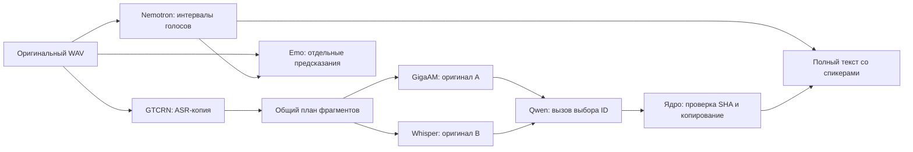

# Quality engine: неизменяемые кандидаты и последовательные процессы

Принято:2026-11-07. Android AVD4096MiB; целевой бюджет приложения2GB с резервом128MiB. Все шесть модельных этапов включены по умолчанию. Backend и публичная схема Transcript остаются совместимыми.

Стрелки обозначают зависимости данных. Один активный job. Тяжёлые модели по-прежнему запускаются по одной в `:inference`. Определитель языка — исключение: обрезанный Whisper tiny читает первые 30 с оригинала в процессе приложения, пока `:inference` считает Nemotron. Для `ru` и `be` цепочка ниже не меняется, whisper.cpp остаётся с `-l ru`. Для другого кода GigaAM и Qwen для этой записи не запускаются, whisper.cpp получает `-l <код>`, текст берётся из Whisper, `fullProfileCompleted` остаётся false. Если определитель не ответил, запись идёт по русской цепочке и в предупреждениях есть `LANGUAGE_ID_UNAVAILABLE`. StageDispatcher адаптирует file-based контракты к sherpa/NeMo-Speech.cpp/whisper.cpp/llama.cpp. Адаптеры не знают о UI и сервере.

ERes2Net читает короткие окна прямо из исходного WAV. `PcmAudio` различает собственный временный PCM и заимствованное WAV-представление со смещением data: только собственный файл удаляется при close. Энергии и AGC считаются по прежним отсчётам; отдельная полная voiceprint-копия не нужна. Fingerprint обработки голосов не меняется.

Причина разделения процессов: release модели не гарантирует возврата всех арен native allocator и ORT. Bound service `:inference` уничтожается между стадиями; IPC передаёт только пути и маленькие управляющие сообщения. После завершения требуется смерть конкретного Binder. У native children установлен parent-death SIGKILL; recovery ограничен зарегистрированными дочерними процессами с проверкой PID reuse.

Состояние job записывается атомарно с fsync. Requestnonce связывает ответ с текущей попыткой. Отдельный terminal artifact защищает memory-error от позднего промежуточного checkpoint. Отмена не удаляет готовые raw artifacts. Отсутствие подтверждённого завершения worker запрещает следующий запуск с потенциальным пересечением моделей.

Единая шкала: integer samples16kHz. ChunkPlan сохраняет все samples без пропусков и дублей. GigaAM и Whisper получают точно те же байты. Каждый кандидат содержит source/chunk/inputSHA, дословный text, native tokens и относительные times. Исходные native JSON сохраняются отдельно; производные слова/спикеры не переписывают их. Overlap RTTM не схлопывается; для одного слова сумма union-overlap по спикеру определяет отображаемого говорящего. Вне акустических интервалов — unknown, без выдуманного предыдущего голоса.

LLM не передаёт окончательный текст. Локальный инструмент принимает строго три строки: tool/chunk_id/source, запрещает дополнительные поля и проверяет кандидатов. Для каждого запроса SDK заранее связывает инструмент и chunk_id; Qwen возвращает только JSON-строку `"gigaam"` или `"whisper"` по ограниченной схеме. SDK сохраняет `bound-tool-call.json` и передаёт его через тот же строгий инструмент. Это сокращает генерацию без разрешения переписывать текст или выбирать другой фрагмент. Audit `scoped_source_v1` связывает SHA фактического stdout, SHA вызова и SHA скопированного оригинала; прежний `tool_json_v1` остаётся совместимым.

Порядок кандидатов чередуется по ID; постоянного предпочтения ASR нет. Невалидный ответ/timeout/слишком большой prompt дают UNRESOLVED, а не незаметную генерацию или усечение. Оригиналы и полный текст сохраняются всегда, когда ASR вернул результат. Если оба ASR упали, gap фиксируется в warnings; невозможно обещать распознавание такого фрагмента.

Память: RSS всех same-UID процессов + reserve, отдельный worker и child watchdog. Это наблюдаемая граница с sampling, не cgroup hard cap. WhisperLarge использует beam1/bestof1/flash-attention, Qwen ctx1024/batch128/ub64 безthinking/repack. Больший beam без APK-замера не включается. Stage deadlines масштабируются по числу чанков, per-child timeout остаётся ограниченным.

Ограничения: Qwen оценивает текстовую правдоподобность, не слушает аудио; корректность выбора требует отдельного WER-эксперимента. Акустическая задержка GTCRN не выверена. Speaker IDs локальны для записи; новый dev voiceprint registry сохранён через отдельный ERes2Net worker и точный checkpoint/frontend fingerprint. Retention jobs, разрешение спикера при overlap и устойчивость на длинных сложных разговорах требуют дальнейшей продуктовой работы. ARM64 сборка проверяется отдельно от фактического исполнения.

### Выходные артефакты и экономия повторной работы

`core.json` сохраняется до сравнения ASR; `transcript.json` содержит только поля образца ТЗ, `transcript.metadata.json` — внутренние эмоции. Структурированный `completion.json` schemaVersion2 связывает SHA обоих выходов, времена стадий, суммарную память и counts: ожидаемые чанки, оба ASR, выбранные/неподтверждённые и подтверждённые локальной LLM. Наличие текста после fallback не доказывает выполнение LLM.

При обработке из Vexto задача получает постоянный UUID. Контрольная точка привязана к SHA-256 исходного аудио и точному манифесту моделей. После перезапуска движок проверяет результаты этапов и продолжает с первого незавершённого. Распознавание и выбор кандидатов сохраняют прогресс по фрагментам, оценка эмоций — по репликам. Прерванный вызов модели повторяется с последней границы сохранения. Если движок уже закончил, приложение публикует готовый результат без повторного инференса.

Кеш проверки весов живёт только до завершения процесса. Совпасть должны digest **байтов** манифеста и атрибуты всех файлов, включая fileKey и точное время изменения. Если файловая система не даёт идентичность или файл меняется во время проверки, кеш не используется. Хеширование первой загрузки и проверка RAW ASR не отключены.

При диагностическом офлайн-прогоне SDK только передаёт файлы и собирает доказательства. Все модели, финальная сборка и JSON-экспорт выполняются на Android; исходное состояние сети восстанавливается после прогона.

### Ограничение временного WAV-хранилища

Сначала вычисляется SHA canonical RIFF44+PCM-range каждого чанка. GigaAM/Whisper по очереди материализуют тот же диапазон, проверяют его SHA и сохраняют неизменяемый результат; generated WAV удаляется в finally после завершения вызова. Хранилище не растёт до третьей полной копии записи. Сбой worker может оставить один временный чанк: при совпадении SHA следующий ASR может его использовать и сохранить для аудита. Исходные WAV и RAW ASR не являются целями cleanup.

Проверяющая утилита поддерживает оба формата артефактов: retained chunks и on-demand policy. В последнем случае она проверяет SHA всей ASR-копии и восстанавливает только байты RIFF/PCM для вычисления chunk SHA; модели на компьютере не запускаются.
