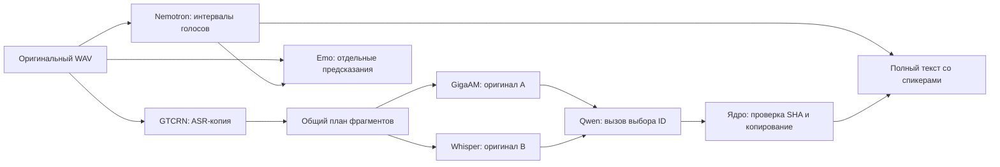

# Quality engine: неизменяемые кандидаты и последовательные процессы

Принято:2026-11-07. Android AVD4096MiB; целевой бюджет приложения2GB с резервом128MiB. Все шесть модельных этапов включены по умолчанию. Backend и публичная схема Transcript остаются совместимыми.

Стрелки обозначают зависимости данных. Исполнение строго последовательное: один активный job и одна тяжёлая модель. StageDispatcher адаптирует file-based контракты к sherpa/NeMo-Speech.cpp/whisper.cpp/llama.cpp. Адаптеры не знают о UI и сервере.

Причина разделения процессов: release модели не гарантирует возврата всех арен native allocator и ORT. Bound service `:inference` уничтожается между стадиями; IPC передаёт только пути и маленькие управляющие сообщения. После завершения требуется смерть конкретного Binder. У native children установлен parent-death SIGKILL; recovery ограничен зарегистрированными дочерними процессами с проверкой PID reuse.

Состояние job записывается атомарно с fsync. Requestnonce связывает ответ с текущей попыткой. Отдельный terminal artifact защищает memory-error от позднего промежуточного checkpoint. Отмена не удаляет готовые raw artifacts. Отсутствие подтверждённого завершения worker запрещает следующий запуск с потенциальным пересечением моделей.

Единая шкала: integer samples16kHz. ChunkPlan сохраняет все samples без пропусков и дублей. GigaAM и Whisper получают точно те же байты. Каждый кандидат содержит source/chunk/inputSHA, дословный text, native tokens и относительные times. Исходные native JSON сохраняются отдельно; производные слова/спикеры не переписывают их. Overlap RTTM не схлопывается; для одного слова сумма union-overlap по спикеру определяет отображаемого говорящего. Вне акустических интервалов — unknown, без выдуманного предыдущего голоса.

LLM не передаёт окончательный текст. Локальный инструмент принимает строго три строки: tool/chunk_id/source, запрещает дополнительные поля и проверяет кандидатов. Порядок кандидатов чередуется по ID; постоянного предпочтения ASR нет. Невалидный ответ/timeout/слишком большой prompt дают UNRESOLVED, а не незаметную генерацию или усечение. Оригиналы и полный текст сохраняются всегда, когда ASR вернул результат. Если оба ASR упали, gap фиксируется в warnings; невозможно обещать распознавание такого фрагмента.

Память: RSS всех same-UID процессов + reserve, отдельный worker и child watchdog. Это наблюдаемая граница с sampling, не cgroup hard cap. WhisperLarge использует beam1/bestof1/flash-attention, Qwen ctx1024/batch128/ub64 безthinking/repack. Больший beam без APK-замера не включается. Stage deadlines масштабируются по числу чанков, per-child timeout остаётся ограниченным.

Ограничения: Qwen оценивает текстовую правдоподобность, не слушает аудио; корректность выбора требует отдельного WER-эксперимента. Акустическая задержка GTCRN не выверена. Speaker IDs локальны для записи; новый dev voiceprint registry сохранён через отдельный ERes2Net worker и точный checkpoint/frontend fingerprint. Retention jobs, разрешение спикера при overlap и устойчивость на длинных сложных разговорах требуют дальнейшей продуктовой работы. ARM64 сборка проверяется отдельно от фактического исполнения.
