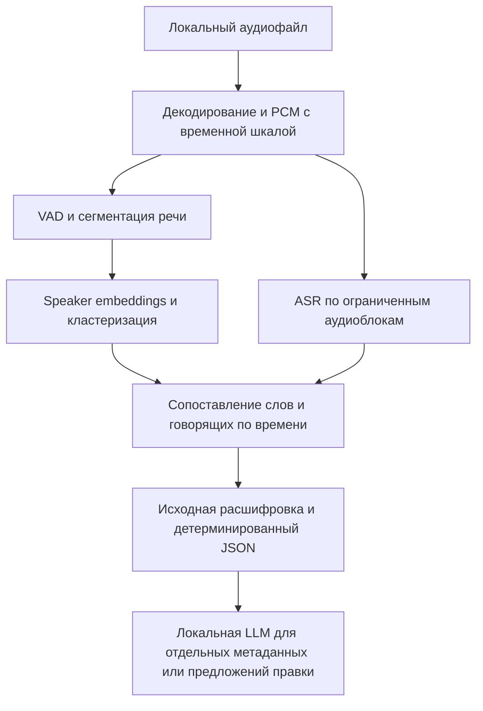

# Локальные модели Vexto для Android с 4 ГБ RAM

Дата исследования и практических проб: **6 ноября 2026**. Цель — выбрать исполнимый стек для [задания хакатона](../hackathon-2026-11.md), а не только найти небольшие файлы моделей. Русский язык принят как основной рабочий сценарий; язык закрытых тестов организаторов ещё не подтверждён.

**Вывод:** на нашем Android x86_64 уже реально запущены Silero VAD, русские GigaAM v2 и маленький Zipformer, связка pyannote segmentation + CAM++, а также Qwen3-0.6B. Все они помещаются в 4 ГБ при отдельных запусках. Работоспособность единого APK, длинных записей и качество на тестах хакатона этим не доказаны. Для первого прототипа приоритетна связка **sherpa-onnx + GigaAM v2 INT8 + pyannote INT8/CAM++**, а для LLM — сравнение уже запущенной Qwen3-0.6B с Qwen2.5-0.5B-Instruct.

Отдельный проектный материал описывает [локальную диаризацию и фоновую идентификацию спикеров между разговорами](local-diarization-speaker-identification.md). В нём предложены схема хранения, очередь и каркас реализации.

## Что проверено экспериментом

Результаты: [15 измеренных запусков и 3 качественные пробы LLM](results/android-4gb-2026-11-06.json). Сборщик: [`probe_android_models.py`](../../tools/benchmarks/probe_android_models.py). Файлы, URL, размеры и SHA256: [манифест артефактов](results/artifacts-2026-11-06.json).

Среда: Pixel_7, Android API 36 / образ 36.1, **4096 МБ**, 4 виртуальных CPU, native x86_64, CPU Intel Core Ultra 7 258V, без GPU/NPU-инференса. `MemTotal` — 4 008 620 КиБ, в начале повторного прогона доступно около 2,3 ГиБ. В ABI list присутствует arm64-v8a, но измерялись именно x86_64-бинарники, без перевода ARM-кода.

Каждая задача выполнялась отдельным native-процессом три раза. Ниже медиана времени всего процесса, включая загрузку модели, и максимальный RSS из трёх запусков. Это не PSS Android-приложения и не Java heap.

| Задача и точный вариант | Тестовое аудио | Полное время, медиана | RTF с загрузкой | Максимальный RSS |
|---|---:|---:|---:|---:|
| Silero VAD, опубликованный `silero_vad.onnx`, 643 854 байта | 16 с, английский | 0,136 с | 0,009 | 73,5 МиБ |
| pyannote segmentation-3.0 INT8 + CAM++ en VoxCeleb, авто-кластеризация | 16 с, два английских голоса | 1,067 с | 0,067 | 154,0 МиБ |
| GigaAM v2 RNNT, INT8 encoder, 2 потока | 11,29 с, русский | 1,525 с | 0,135 | 433,2 МиБ |
| Small Zipformer RU, INT8 encoder/joiner, FP32 decoder, 2 потока | тот же русский файл | 2,139 с | 0,190 | 204,5 МиБ |
| Qwen3-0.6B Q8_0, CPU, `llama-bench`, 2 потока | текстовый synthetic bench | 4,500 с на pp128 + tg32 | неприменимо | 695,1 МиБ |

Для Qwen3 генерация в трёх отдельных benchmark-процессах последней проверенной серии составила **27,5–34,1 токена/с**, медиана около **33,5**. В предыдущих сериях наблюдались 18,7–30,6 токена/с, а один benchmark с тремя внутренними повторами дал 28,2 токена/с. Это разные серии: разброс нужно сохранять, а не выбирать только более красивое число. В русских prompt-пробах с контекстом 1024 максимум RSS был **784,5 МиБ**.

Два ASR-варианта вернули русский текст и временные метки токенов. Диаризация без заданного числа участников вернула две уникальные метки на четырёх интервалах: `speaker_00` и `speaker_03`. Пропуски номеров не означают четыре найденных голоса; перед экспортом ID можно последовательно перенумеровать.

Нет размеченного эталона для WER/DER: это **функциональные и ресурсные пробы**, не рейтинг точности. Английский тест диаризации не доказывает качество русских диалогов. Маленький Zipformer здесь быстрее на собственно декодировании, но медленнее по времени процесса из-за инициализации — размер весов сам по себе не предсказывает задержку.

### Что ограничивает эти замеры

- Native CLI в `adb shell` не включает UI, MediaCodec, хранение результатов, жизненный цикл APK и его поведение под LMKD.
- Новый процесс не означает холодный файловый кэш; кэши намеренно не сбрасывались. Фоновые задачи и планировщик меняют результаты.
- Скорость эмулятора на CPU ноутбука нельзя выдавать за скорость физического Pixel 7 или бюджетного телефона.
- Успех на 11–16 секундах не доказывает ограниченную память на часовой записи или устойчивость к overlap.
- `RSS` включает резидентные страницы native-библиотек. Суммировать независимые максимумы как точный прогноз общей памяти некорректно.

## Зачем нужен каждый компонент



ASR отвечает «что сказали», диаризация — «кто и когда говорил», VAD — «где есть речь». LLM не должна угадывать акустические границы или говорящих по готовому тексту. JSON с `speaker_id`, `start_ms`, `end_ms`, `text` формируется обычным кодом.

## Распознавание речи

Основной короткий список для первых сравнительных тестов:

| Модель | Язык и размер | Статус на нашем Android | Решение |
|---|---|---|---|
| **GigaAM v2 RNNT INT8** | Русский; использованные три ONNX-файла около 230 МиБ | **Проверена**, пик 433 МиБ | Первый рабочий ASR-кандидат. Готовые модели и Android-интеграция sherpa-onnx. [Документация](https://k2-fsa.github.io/sherpa/onnx/pretrained_models/offline-transducer/nemo-transducer-models.html) |
| **Small Zipformer RU INT8** | Русский; использованные ONNX-файлы около 26,2 МиБ | **Проверена**, пик 204 МиБ | Лёгкий запасной вариант и база для сравнения. Исходная модель — `alphacep/vosk-model-small-ru`, Apache-2.0. Это НЕ классический Kaldi `vosk-model-small-ru-0.22`. [Карточка](https://huggingface.co/alphacep/vosk-model-small-ru), [экспорт](https://k2-fsa.github.io/sherpa/onnx/pretrained_models/offline-transducer/zipformer-transducer-models.html) |
| **Whisper tiny / base / small multilingual** | Русский поддерживается; `.en` варианты не подходят | Android-путь подтверждён документацией, локально не измерены | Следующий обязательный baseline, прежде всего `base` и `small`; `tiny` — минимальный smoke test. [whisper.cpp](https://github.com/ggml-org/whisper.cpp), [Android example](https://github.com/ggml-org/whisper.cpp/tree/master/examples/whisper.android) |
| **GigaAM v3 / v3 e2e** | Русский, в e2e есть пунктуация и нормализация | Не запускалась | Приоритетная проверка качества после v2; есть официальный ONNX export. Совместимость конкретного v3-экспорта с используемым runtime нужно проверить, её нельзя выводить из успешного v2. [Авторы](https://github.com/salute-developers/GigaAM) |
| **Qwen3-ASR-0.6B** | Включает русский; отдельная ASR-модель, не Qwen3 chat | Не запускалась | Современный кандидат с ONNX/Kotlin/Java интеграцией sherpa. Измерить память и авторегрессионную задержку до повышения приоритета. Apache-2.0. [Карточка](https://huggingface.co/Qwen/Qwen3-ASR-0.6B), [интеграция](https://k2-fsa.github.io/sherpa/onnx/qwen3-asr/index.html) |

Whisper.cpp приводит для обычных вариантов ориентиры: tiny — 75 МиБ на диске / около 273 МБ памяти, base — 142 МиБ / 388 МБ, small — 466 МиБ / 852 МБ. Это опубликованные оценки проекта, **не замеры нашего AVD**. Квантизация уменьшает веса, но не устраняет память активаций и декодера. Для medium/large запас при 4 ГБ значительно хуже, поэтому не начинать с них. [Таблица авторов](https://github.com/ggml-org/whisper.cpp#memory-usage)

Другие варианты, которые стоит держать в каталоге:

- **Классический Vosk small RU 0.22:** файл около 45 МБ, авторы оценивают типичную память small-моделей около 300 МБ, лицензия Apache-2.0. Полезен как очень простой офлайн Android-baseline; качество на их разных корпусах сильно различается. [Каталог](https://alphacephei.com/vosk/models)
- **T-one:** русский streaming CTC для телефонии, 8 кГц; опубликован ONNX около 138 МБ. Встречи с широкополосным звуком — другой домен, обязательны собственные сравнения. [Авторы](https://github.com/voicekit-team/T-one), [sherpa integration](https://k2-fsa.github.io/sherpa/onnx/pretrained_models/online-ctc/t-one-ctc-models.html)
- **NVIDIA FastConformer Hybrid Large RU:** около 115M параметров, русский с пунктуацией/регистром, CC-BY-4.0. Возможный ONNX/INT8-кандидат, но пока без нашего Android-замера. [Карточка NVIDIA](https://huggingface.co/nvidia/stt_ru_fastconformer_hybrid_large_pc)
- **Nemotron 3.5 ASR streaming 0.6B multilingual:** документация уже включает русский; рассматривается как дополнительный streaming-кандидат после лёгких вариантов, а не как гарантированно более экономная модель. Английский Nemotron checkpoint не равнозначен multilingual. [Модели и языки](https://k2-fsa.github.io/sherpa/onnx/nemo/nemotron-streaming.html)
- **SenseVoice Small:** компактная и удобная, но в заявленных языках нет русского. Для русского сценария исключить из основного списка. [Официальный список языков](https://k2-fsa.github.io/sherpa/onnx/sense-voice/)

## Разделение говорящих и частота голоса

### Почему нельзя сортировать людей только по частоте

F0 — высота основного тона, а не уникальный отпечаток человека. У одного участника F0 меняется при эмоциях и интонации; диапазоны разных участников пересекаются. Шёпот и глухие звуки не дают устойчивого F0, а при наложении голосов одна траектория тона не разделяет источники.

**YIN** — алгоритм оценки F0 без нейросетевых весов; **CREPE / torchcrepe tiny** — нейросетевой pitch tracker. Они пригодны для диагностики и вспомогательных признаков, но не заменяют speaker embeddings. Это инженерный вывод из назначения этих инструментов. [YIN](https://librosa.org/doc/0.11.0/generated/librosa.yin.html), [CREPE](https://github.com/marl/crepe), [torchcrepe](https://github.com/maxrmorrison/torchcrepe)

Для диаризации нужны: сегментация и обнаружение смены голосов → embeddings каждого пригодного фрагмента → кластеризация по похожести → привязка кластеров к общей временной шкале. Количество людей не следует заранее фиксировать равным двум: закрытые тесты могут содержать другое число участников.

### Embeddings и сегментация

| Компонент | Что установлено | Применение |
|---|---|---|
| **pyannote segmentation-3.0 ONNX INT8** | Наш файл 1 540 506 байт; исходная модель MIT | Проверенная сегментация; это не полный Python pipeline pyannote. [Карточка](https://huggingface.co/pyannote/segmentation-3.0), [sherpa](https://k2-fsa.github.io/sherpa/onnx/speaker-diarization/models.html) |
| **3D-Speaker CAM++ en VoxCeleb** | Наш ONNX 29 596 978 байт; работает в связке выше | Текущий baseline по ресурсам. Apache-2.0 у кода 3D-Speaker не является отдельным доказательством лицензии точного English checkpoint: его model card нужно сохранить перед распространением APK. [Код](https://github.com/modelscope/3D-Speaker), [checkpoint](https://modelscope.cn/models/iic/speech_campplus_sv_en_voxceleb_16k) |
| **ERes2Net** | В релизах sherpa есть разные варианты: около 26,5 МБ для en VoxCeleb, 39,6 МБ для base 3D-Speaker, другие существенно больше | Разумный A/B для embeddings. Выбирать конкретный checkpoint, а не только название архитектуры. [Артефакты](https://github.com/k2-fsa/sherpa-onnx/releases/tag/speaker-recongition-models) |
| **TitaNet Small** | Готовый sherpa ONNX около 40,3 МБ, 192-мерные embeddings | Второй практичный вариант. Карточка NGC ссылается на лицензию NeMo; не приписывать всем TitaNet-весам одну лицензию по сторонним спискам. [NVIDIA](https://catalog.ngc.nvidia.com/orgs/nvidia/teams/nemo/models/titanet_small), [Android APKs](https://k2-fsa.github.io/sherpa/onnx/speaker-diarization/apk.html) |
| **SpeechBrain ECAPA-TDNN VoxCeleb** | Карточка весов Apache-2.0, набор файлов около 89 МБ | Полезное сравнение качества; готовый Python recipe не означает готовую Android-интеграцию. Verification EER нельзя считать DER всей системы. [Модель](https://huggingface.co/speechbrain/spkrec-ecapa-voxceleb) |

**Ограничения, важные для тестов:**

- Сегментация pyannote-3.0 обрабатывает окна по 10 секунд, до трёх локальных говорящих и не более двух одновременно. Это не предел числа участников всей записи, но сложный локальный эпизод может выйти за ограничения. [Карточка](https://huggingface.co/pyannote/segmentation-3.0)
- В sherpa **v2.0.1** для записи, помещающейся в одно окно, есть специальный путь до embeddings/clustering. Поэтому тест короче 10 секунд не доказывает работу всего стека. Наша проверка длилась 16 секунд. Эта деталь привязана к версии runtime. [Реализация](https://github.com/k2-fsa/sherpa-onnx/blob/v2.0.1/sherpa-onnx/csrc/offline-speaker-diarization-pyannote-impl.h)
- В том же коде overlap исключается при извлечении embeddings, а слишком короткие пригодные участки пропускаются. Голос, слышимый только поверх другого, может остаться без хорошего embedding. Диаризация не создаёт очищенные отдельные аудиодорожки.
- Порог 0,5 — исходная настройка нашей пробы, не универсально правильное значение. Проверять похожие голоса, короткие «да/нет», шум и возвращение участника после длинной паузы. [Настройка кластеризации](https://k2-fsa.github.io/sherpa/onnx/speaker-diarization/models.html)

Полные **pyannote community-1** и **WhisperX** полезны как эталон идей и офлайн-инструменты оценки на компьютере. Они не являются доказанным Android runtime для приложения; серверный инференс вместо Android запрещён заданием. Состав pipeline и лицензии моделей проверяются отдельно. [Community-1](https://huggingface.co/pyannote/speaker-diarization-community-1), [WhisperX](https://github.com/m-bain/whisperX)

## Локальная LLM

Наличие локальной LLM — **обязательное условие задания**. Рекомендация ниже отделяет её работу от исходного текста, который оценивается по WER; она не предлагает исключить LLM из решения. Конкретную роль модели всё равно нужно объяснить на защите и при необходимости подтвердить у организаторов.

| Модель и вариант | Проверенный размер артефакта | Статус и вывод |
|---|---:|---|
| **Qwen3-0.6B Q8_0** | 639 446 688 байт | **Реально запущена**. Apache-2.0; русский поддерживается. Есть измерения вместимости, но пока нет надёжной постобработки. [Официальный GGUF](https://huggingface.co/Qwen/Qwen3-0.6B-GGUF/tree/main) |
| **Qwen2.5-0.5B-Instruct Q4_K_M** | 491 400 032 байта | Следующий A/B без reasoning-режима; card включает русский и структурированный вывод. Не запускалась. [Карточка](https://huggingface.co/Qwen/Qwen2.5-0.5B-Instruct), [GGUF](https://huggingface.co/Qwen/Qwen2.5-0.5B-Instruct-GGUF/tree/main) |
| **Qwen3-1.7B Q8_0** | 1 834 426 016 байт | Уже одни веса занимают значительную часть доступной RAM. Q4 может быть отдельным экспериментом, но не первый baseline; Q4 здесь не измерялся. Apache-2.0. [Файлы](https://huggingface.co/Qwen/Qwen3-1.7B-GGUF/tree/main) |
| **Qwen3.5-0.8B Q4_0** | около 563 МБ, ggml-org GGUF | Современный кандидат, Apache-2.0, гибридная архитектура; требует совместимого runtime. Не запускалась; размер не доказывает хорошую русскую пунктуацию. Card отдельно предупреждает о thinking loops у 0.8B. [Карточка](https://huggingface.co/Qwen/Qwen3.5-0.8B), [GGUF](https://huggingface.co/ggml-org/Qwen3.5-0.8B-GGUF/tree/main) |
| **Gemma 3 270M IT QAT Q4_0** | около 241 МБ, ggml-org GGUF | Очень компактная для узкой специализированной задачи; собственная лицензия Gemma, не Apache. Русское качество и необходимость дообучения проверить отдельно. [Google](https://developers.googleblog.com/introducing-gemma-3-270m/), [GGUF](https://huggingface.co/ggml-org/gemma-3-270m-it-qat-GGUF/tree/main) |
| **Gemma 3 1B IT QAT Q4_0** | около 1 ГБ | Запасной эксперимент после меньших моделей. Лицензия Gemma и принятие условий доступа. [Google GGUF](https://huggingface.co/google/gemma-3-1b-it-qat-q4_0-gguf/tree/main) |
| **SmolLM2 360M Instruct Q8_0** | около 386 МБ | Apache-2.0, но card прямо указывает преимущественно английский язык. Низкий приоритет для русского. [Card](https://huggingface.co/HuggingFaceTB/SmolLM2-360M-Instruct) |

Размеры в этой таблице относятся к конкретным форматам, а не ко всем конвертациям архитектуры. В частности, официальный Qwen3-0.6B GGUF на момент проверки содержит Q8_0; предполагаемый сторонний Q4 не следует выдавать за испытанный официальный артефакт. У Qwen2.5-0.5B Q4_K_M неожиданно немаленький файл — название «0.5B» не заменяет проверку реальных байтов.

### Что показали русские prompt-пробы

Задача: добавить пунктуацию без изменения слов в собственной фразе «сегодня проверим распознавание речи потом экспортируем результат».

1. Ручной chat prompt с автоматическим conversation-режимом дал правильную фразу, но пропустил в вывод `<think>`. Двойное шаблонизирование не подходит для интеграции.
2. Автоматический conversation с `--reasoning off` продолжил рассуждать по-английски и исчерпал 96 токенов без конечного ответа.
3. Raw prompt с закрытым thinking-prefill и `--no-conversation` вернул переставленные слова. Лексическая последовательность не сохранилась.

Это три конкретные конфигурации, а не доказательство невозможности хорошего результата у Qwen3. Для неё официальный hard switch — `enable_thinking=False` при применении chat template; soft instruction — `/no_think`. Флаг UI/runtime, отвечающий за показ reasoning, нельзя автоматически считать правильным изменением шаблона. [Инструкция Qwen](https://huggingface.co/Qwen/Qwen3-0.6B)

**Предлагаемая роль:** отдельный короткий заголовок/тема диалога, извлечение задач или проверяемые предложения пунктуации. Исходный `rawTranscript` хранить неизменным. Для применения пунктуации проверять неизменность последовательности слов; при перестановке, добавлении или удалении слов отклонять правку. Не просить LLM определять реальные времена, акустические speaker ID или генерировать обязательный экспорт с нуля.

Для Qwen3 начать с контекста 1024–2048, небольшого выхода и проверенного шаблона без thinking. Не выделять максимальный контекст из карточки: KV cache и рабочие буферы занимают дополнительную RAM. Длинную стенограмму обрабатывать частями с сохранением исходных сегментов.

## Вспомогательные модели

| Компонент | Назначение и решение |
|---|---|
| **Silero VAD** | Уже проверен; отделяет речь от пауз. VAD не обнаруживает личность и не гарантирует точных границ смены говорящего. Короткие ответы требуют настройки минимальной длительности. [Авторы](https://github.com/snakers4/silero-vad) |
| **GTCRN** | Лёгкое шумоподавление; авторы приводят 48,2k параметров, MIT и ONNX-путь. Кандидат для A/B, не включать автоматически: улучшение слышимости не равно улучшению WER/DER. [Авторы](https://github.com/Xiaobin-Rong/gtcrn), [sherpa API](https://k2-fsa.github.io/sherpa/onnx/c-api/html/speech_enhancement.html) |
| **RNNoise** | Native C, код BSD-3-Clause; documented PCM 48 кГц потребует resampling вокруг 16-кГц моделей. Условия конкретных распространяемых весов проверяются отдельно. Это не разделение нескольких голосов. [Авторы](https://github.com/xiph/rnnoise) |
| **Forced alignment / CTC alignment** | Нужен, если собственные ASR-метки недостаточны. Начать с доступных token timestamps и акустических границ; отдельная alignment-модель увеличит интеграцию и память. WhisperX показывает такой подход, но его Python pipeline не переносится в Android автоматически. [WhisperX](https://github.com/m-bain/whisperX) |
| **Пунктуация отдельной моделью** | Возможна вместо свободного переписывания LLM, но всё равно требуется локальная LLM по заданию. Классический Vosk RU recasepunc около 1,6 ГБ неудачен как первый выбор на 4 ГБ. [Каталог Vosk](https://alphacephei.com/vosk/models) |
| **Source separation** | Отдельный дорогой этап для overlap. Не смешивать с diarization/denoising; сначала измерить ошибки на перебиваниях, затем решать, оправдан ли дополнительный инференс. |

Исходный PCM сохранять для диаризации, а denoised-копию сначала проверять только как альтернативный вход ASR: фильтрация может изменять голосовые признаки. Это гипотеза для A/B, не уже установленное ухудшение.

## Runtime и память

- **sherpa-onnx 2.0.1 / ORT 1.28.2** уже исполняют ASR, VAD и диаризацию на нашем Android. Есть native API и Java/Kotlin интеграция; Android APK перечислены по ABI. [Документация](https://k2-fsa.github.io/sherpa/onnx/)
- **llama.cpp** — проверенный путь GGUF. Android bindings включают x86_64 и arm64; пример NDK-сборки нужно адаптировать под нужную ABI, а не копировать ARM-флаги в эмулятор. [Android guide](https://github.com/ggml-org/llama.cpp/blob/master/docs/android.md), [ABI filters](https://github.com/ggml-org/llama.cpp/blob/master/examples/llama.android/lib/build.gradle.kts)
- **ONNX Runtime Android** подходит для собственных графов, но наличие `.onnx` не гарантирует поддержку всех операций, форм входов и конкретной квантизации. Начинать с CPU, ускорители проверять отдельно. [Java/Android API](https://onnxruntime.ai/docs/get-started/with-java.html)
- **LiteRT-LM** имеет актуальные x86_64 prebuilt-файлы; старое утверждение «Google LLM runtime не работает в эмуляторе» нельзя переносить на все версии 2026 года. Здесь он не тестировался и пока не даёт причины менять уже работающий llama.cpp. [Official x86_64](https://github.com/google-ai-edge/LiteRT-LM/tree/main/prebuilt/android_x86_64)

На нашем AVD Java heap growth limit — 192 МБ, max heap — 576 МБ. Весовые массивы нельзя просто загрузить целиком в Java `ByteArray` и считать, что приложению доступны все 4 ГБ. Native allocations и mmap имеют отдельный учёт, но всё равно конкурируют за общую RAM и подчиняются ограничениям жизненного цикла Android.

Рекомендуемый порядок — ограниченные аудиоблоки, отдельные фазы ASR/диаризации/LLM, освобождение тяжёлых сессий и файловые промежуточные результаты. Последовательность даёт шанс удержать пик около максимума этапов, но выгрузку и возврат памяти нужно измерить в APK; это не автоматическая гарантия.

Для масштаба: час mono PCM16 при 16 кГц занимает около 115,2 МБ, float32 — около 230,4 МБ ещё до признаков и моделей. Хранение нескольких копий записи, mel-признаков, embeddings и матрицы попарных расстояний может съесть запас. Не собирать всё в памяти ради удобства.

## Воспроизведение эксперимента

Все скачанные бинарники и модели находятся в игнорируемой `.agents/work/model-research/`, а на устройстве — под `/data/local/tmp/vexto-model-research`. Эти пути относятся к probe, не к будущей структуре APK. Никакие модели или APK не добавлены в Git.

1. Запустить обычный Pixel 7 с 4096 МБ и проверить `sys.boot_completed=1`, ABI и `MemTotal`.
2. Скачать файлы из [манифеста](results/artifacts-2026-11-06.json), проверить размер и SHA256, распаковать архивы. Для переносимости использовать явно выбранный SDK `adb`.
3. Поместить `bin/` и `lib/` из **shared** Android x86_64 Termux-сборки sherpa в remote root. Ей требуется `libc++_shared.so`: библиотека взята из указанного в манифесте официального пакета Termux, проверена по SHA256 и скопирована в `lib/`. Ничего не устанавливать в системные каталоги Android.
4. Подготовить файлы по таблице ниже. Для LLM распаковать native файлы перечисленных Termux-пакетов в `llama/bin/` и `llama/lib/`; системная установка Termux не нужна. Их версии/хэши сохранены в манифесте. Экспериментальный package build не заменяет воспроизводимую NDK-сборку для релизного APK.
5. Выполнить probe. Он запускает задачи последовательно, проверяет код возврата, непустой ASR с timestamps, число разных голосов и границы интервалов, затем сохраняет результаты и логи.

| Локальный артефакт | Путь относительно remote root |
|---|---|
| pyannote `model.int8.onnx` | `segmentation.int8.onnx` |
| CAM++ English ONNX | `campplus.onnx` |
| Silero ONNX | `silero_vad.onnx` |
| `1-two-speakers-en.wav` | `two-speakers-en.wav` |
| Распакованный GigaAM v2 RNNT | `gigaam/` |
| Распакованный Small Zipformer RU | `zipformer/` |
| Официальный Qwen3 GGUF | `Qwen3-0.6B-Q8_0.gguf` |

```powershell
# $adbPath — путь к platform-tools/adb.exe выбранного Android SDK.
# $deviceSerial — проверенный serial именно нужного AVD.
python tools/benchmarks/probe_android_models.py `
  --adb $adbPath --serial $deviceSerial `
  --output-dir .agents/work/model-research/recheck `
  --repeats 3 --include-llm
```

Три качественные LLM-пробы выполнены вручную: полные prompts и точные команды сохранены в JSON результатов. Они не запускаются флагом `--include-llm`, который добавляет только ресурсный `llama-bench`.

Probe не вычисляет WER/DER и не скачивает модели автоматически. Параметры ASR — 2 потока, diarization/VAD — по 1; LLM — 2 потока, CPU, pp128/tg32, по одному внутреннему повтору на каждый из трёх отдельных процессов. В исходных логах сохранены и время инференса runtime без загрузки, и полное время процесса; в основной таблице использовано второе.

Замечания по подготовке: ссылка на APK diarization 2.0.1 в документации на момент проверки возвращала `Entry not found`; индекс реально содержал версии 1.12.x. APK не был установлен. И shared-, и static-Termux-архивы CLI требовали внешнюю libc++; слово `static` в названии не означает отсутствие всех динамических зависимостей. В архиве GigaAM файл `LICENSE` оказался HTML, поэтому перед распространением надо взять корректный текст лицензии из исходного проекта. Эти ошибки упаковки не являются недостатком модели, но важны для воспроизведения.

## Следующие сравнения и критерии решения

Это оставшиеся эксперименты, не обещание уже полученных результатов:

1. **Общий русский корпус:** 20–50 локально доступных или разрешённых записей, отдельно короткие реплики, похожие голоса, тихая речь, шум и overlap. Разметить слова, времена и говорящих; одинаковая нормализация для всех моделей. Не использовать вывод одного ASR как эталон другого.
2. **ASR:** GigaAM v2 против Whisper base/small, маленького Zipformer и GigaAM v3. Затем Qwen3-ASR-0.6B и FastConformer, если у первых недостаточно качества. Считать WER, timestamp error, init/inference/full RTF и peak RSS/PSS.
3. **Диаризация:** текущая связка против ERes2Net и TitaNet Small. Менять threshold на размеченной validation-части; оценить DER, ошибки привязки слов к людям, merge/split и возврат speaker ID. Проверить 4 быстрых участника за 10 секунд и тройное наложение.
4. **LLM:** Qwen2.5-0.5B Instruct против Qwen3-0.6B с корректным non-thinking template. Проверять одинаковые русские задания: структура/заголовки, валидность формата, добавление фактов, сохранение слов, время первого/последнего токена и RAM на 1024/2048 контексте.
5. **Helpers:** сравнить raw ASR с GTCRN/RNNoise, а диаризацию — на исходном и обработанном сигнале. Добавлять фильтрацию только при измеримом выигрыше по нужной метрике.
6. **APK:** собрать минимальную интеграцию с native ABI x86_64 и arm64-v8a; прогнать офлайн в 4 ГБ, замерить PSS приложения, прерывание/возврат, экспорт JSON и 5/15/30-минутные записи. Следить за ростом памяти и очередями, а не только за отсутствием crash на одном файле.

Начальные инженерные ориентиры, которые команда ещё должна утвердить: отсутствие OOM/ANR, валидный контракт JSON, запас памяти для Android, воспроизводимые метрики и понятный fallback. Порог RTF ≤ 1 можно использовать как цель, но это **не опубликованное условие организаторов**.

Перед выпуском фиксировать отдельно лицензию runtime и каждой модели/конвертации, хранить notices и точные checkpoint/revision/hash. В частности, gate Hugging Face и open-source лицензия — разные вещи; не обходить gate через чужой токен. Архивы в этом исследовании получены из публичных релизов sherpa.
